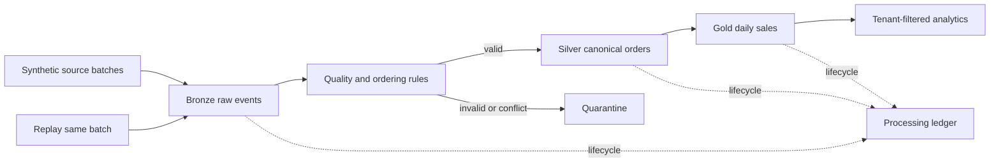

# Architecture and recovery boundaries

Bronze stores immutable synthetic raw events using deterministic record IDs. Silver holds the newest valid state per `(tenant_id, order_id)` and only a greater `event_version` can replace it. Same-version different payloads go to quarantine; older events cannot overwrite current state.

Gold is recomputed from canonical Silver state. Delta commits are atomic per table, not across Bronze, Silver, Gold, and any processing ledger. A rerun therefore reapplies idempotent Bronze identities, recomputes Silver decisions, and refreshes Gold from Silver. No claim of cross-table atomicity is made.

`CANCELLED` orders retain their last booked amount for gross booked revenue and contribute zero to net revenue. Currency is a Gold grouping key; no FX conversion is performed.

All persisted datasets—including Bronze, quarantine, Silver, Gold, manifest, and ledger—carry tenant context. Silver identity is `(tenant_id, order_id)`, preventing equal order IDs in separate tenants from merging.

The processing ledger records `RECEIVED`, `BRONZE_COMMITTED`, `SILVER_COMMITTED`, and `GOLD_COMMITTED`. Failure injection is implemented after each table commit and before that stage's ledger update. Recovery must rerun deterministic Bronze insertion, Silver version processing, and Gold derivation; the ledger alone is not authoritative.

Local configuration requires an explicit storage root and has no secret input. Logs include run ID, batch ID, tenant-scope fingerprint, stage counts, and safe error types. Databricks Workflow and Unity Catalog artifacts are illustrative existing-workspace contracts only; no workspace, identity, secret, or grant has been executed.
